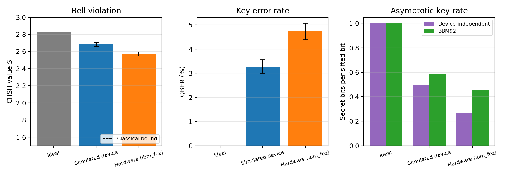
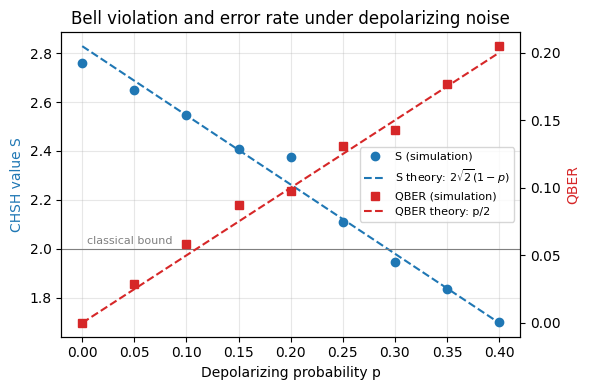
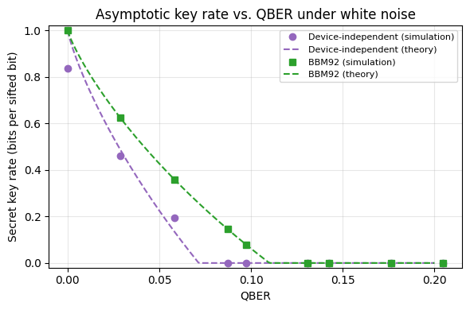
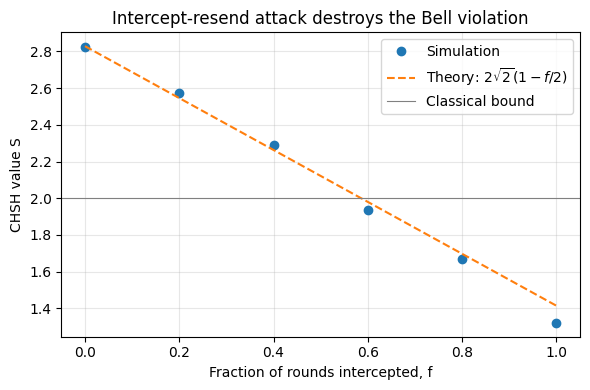
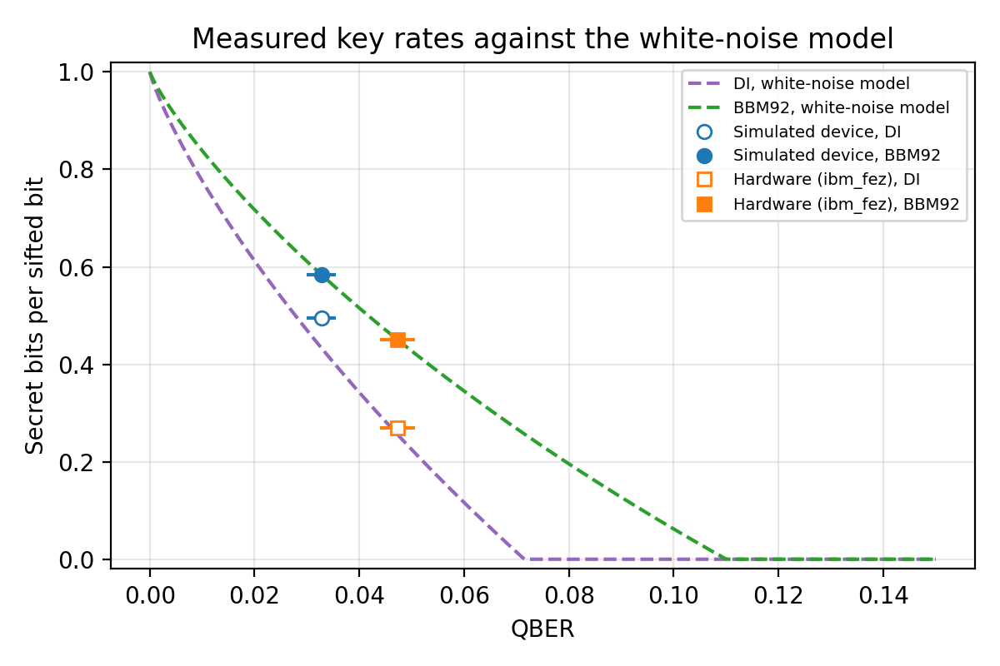

# E91 QKD with Bell-Test Security on IBM Quantum Hardware

Entanglement-based quantum key distribution (E91) with CHSH-based security analysis, implemented in Qiskit and run on the IBM Fez superconducting processor.

Alice and Bob measure shared Bell pairs at random angles. Some rounds produce key bits; the rest estimate the CHSH value S. A violation S > 2 certifies that the correlations are quantum, and its size bounds an eavesdropper's information without trusting the devices.

## Hardware result

| Quantity | FakeFez noise model | ibm_fez hardware |
| --- | --- | --- |
| CHSH value S | 2.683 ± 0.023 | **2.571 ± 0.024** |
| QBER | 3.3 ± 0.3% | **4.7 ± 0.3%** |
| Device-independent key rate | 0.49 | **0.27** |
| BBM92 key rate | 0.58 | **0.45** |

Key rates are asymptotic, in secret bits per sifted bit. The hardware Bell violation is 23.6 standard deviations above the classical bound, and the device-independent key rate is positive.



## Contents

| Path | What it contains |
| --- | --- |
| `notebooks/01_e91_simulation.ipynb` | Protocol in simulation: correlations, depolarizing noise, key rates, intercept-resend attack |
| `notebooks/02_e91_ibm_hardware.ipynb` | Dry run on the FakeFez noise model, hardware run on ibm_fez, comparison |
| `data/hardware_results.json` | Raw hardware outcomes (backend, job ID, settings, bitstrings) |
| `figures/` | Figures 1 to 6 |
| `report/` | Project report |

## Simulation results

| | |
| --- | --- |
|  |  |
| S and QBER under depolarizing noise | Device-independent vs. BBM92 key rate |
|  |  |
| An eavesdropper destroys the Bell violation | Hardware results on the white-noise curves |

## Protocol settings

| Party | Setting 0 | Setting 1 | Setting 2 |
| --- | --- | --- | --- |
| Alice | 0 | π/2 | |
| Bob | π/4 | −π/4 | 0 |

The pair (a₀, b₂) gives key bits; the four pairs (aᵢ, bⱼ) with i, j ∈ {0, 1} give the CHSH estimate.

## Running

```bash
pip install -r requirements.txt
jupyter notebook notebooks/
```

Notebook 02 needs an IBM Quantum account and API key for the hardware section. The saved results in `data/hardware_results.json` can be reanalysed without hardware access.

## Limitations

- Both qubits are on one processor, so locality and detection loopholes are open. This is a demonstration of the protocol and its security analysis, not a deployed QKD link.
- Settings were run in fixed blocks rather than chosen randomly per round.
- Key rates are asymptotic and assume collective attacks.

## References

1. A. K. Ekert, *Phys. Rev. Lett.* 67, 661 (1991).
2. J. F. Clauser, M. A. Horne, A. Shimony and R. A. Holt, *Phys. Rev. Lett.* 23, 880 (1969).
3. C. H. Bennett, G. Brassard and N. D. Mermin, *Phys. Rev. Lett.* 68, 557 (1992).
4. A. Acín et al., *Phys. Rev. Lett.* 98, 230501 (2007).
